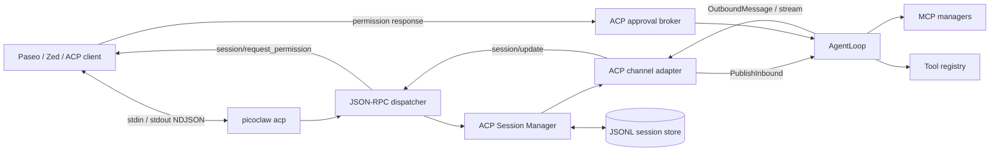

# ACP Integration Design

> Status: Core implemented; session-scoped MCP and advanced lifecycle methods remain open
> Target: `picoclaw acp` as a standalone stdio agent for Paseo, Zed, and other ACP clients

## 1. Decision

PicoClaw will expose an **Agent Client Protocol (ACP)** server through a new
`picoclaw acp` command. The command owns one agent runtime and communicates with
its client using newline-delimited JSON-RPC 2.0 over stdin/stdout.

ACP complements the existing integration surfaces:

- **A2A** remains the protocol for agent-to-agent tasks.
- **Pico WebSocket** remains the protocol for the Web UI and Pico clients.
- **MCP client support** remains how PicoClaw consumes external tools.
- **ACP** is the protocol for a client that owns the interactive agent lifecycle:
  sessions, prompt turns, streaming updates, cancellation, permissions, and
  session configuration.

The first implementation targets ACP v1 and pins the upstream schema used by the
build. Protocol version negotiation happens during `initialize`; PicoClaw does
not assume that a client supports every optional ACP feature.

No Paseo-specific code will be added to PicoClaw. A Paseo provider can launch
`picoclaw acp` directly, or a Paseo provider plugin can provide the adapter.

### Implementation Status

| Area | Status |
|---|---|
| NDJSON JSON-RPC transport, version negotiation, bounded messages | Implemented |
| Standalone runtime with no configured network channels | Implemented |
| `session/new`, `session/prompt`, `session/cancel` | Implemented |
| Message, thought, tool-call, tool-result, and usage updates | Implemented |
| Per-session model and plan/build mode | Implemented |
| ACP permission requests for unknown exec commands | Implemented |
| Slash-command advertisement | Implemented |
| Clean stdout and stable exit codes | Implemented |
| Session history persistence and `session/load` replay | Implemented; selected model/mode are not persisted yet |
| Session-scoped MCP servers | Open; rejected explicitly for now |
| `session/resume`, `session/list`, `session/delete`, `session/close` | Open |
| Client-provided system prompts and additional roots | Open |
| Subagent, plan, and advanced compaction updates | Open |

## 2. Problem

PicoClaw already has most of the runtime capabilities required by an external
agent orchestrator, but it lacks a stable machine-facing client protocol:

- `picoclaw agent -m` prints a logo and human-readable text rather than a
  parseable event stream.
- The Launcher REST API is authenticated with a dashboard cookie and does not
  expose prompt, cancel, steer, or approval operations.
- Pico WebSocket frames are designed for the Web UI and expose chat controls as
  text commands such as `/stop` and `/model`.
- A2A is suitable for remote agent tasks, but it deliberately does not expose
  interactive permission requests and its task registry is in memory.
- Runtime events and process hooks are rich extension points, but neither is a
  client protocol with session lifecycle and permission round-trips.

An ACP client such as Paseo needs to spawn an agent, create sessions, stream
message and tool updates, ask the user for permission, cancel work, and change
models or modes. ACP provides those semantics directly.

## 3. Goals

1. Run PicoClaw as a headless ACP agent without the Gateway or Launcher.
2. Reuse the existing `AgentLoop`, routing, session store, commands, tools,
   steering, cancellation, MCP manager, and usage accounting.
3. Stream user-visible text, thoughts, tool calls, tool results, usage, and
   compaction state through `session/update`.
4. Route sensitive tool calls through ACP `session/request_permission`.
5. Cancel a prompt turn and resolve pending permission requests correctly.
6. Persist ACP sessions across process restarts and support history replay.
7. Expose model, operating mode, and reasoning level through ACP session config
   options, with legacy session modes for older clients.
8. Keep stdout protocol-clean and all diagnostics on stderr.
9. Pass the mandatory checks in the ACP Test Compatibility Kit (TCK), while
   recognizing that the TCK is experimental and not a conformance certificate.

## 4. Non-Goals For The First Release

- A remote HTTP or WebSocket ACP transport. ACP currently standardizes stdio.
- Replacing A2A, Pico WebSocket, the Gateway, or the Launcher API.
- Delegating filesystem or terminal operations to the ACP client. PicoClaw tools
  execute locally in the first release.
- A hosted multi-user ACP service. The stdio process trusts the client that
  launched it and has the permissions of the current OS user.
- An operating-system sandbox. ACP does not provide one.
- Exposing PicoClaw as an MCP server or an OpenAI-compatible model endpoint.
- Replaying subagent trees before the runtime can identify child-parent
  relationships reliably.

## 5. Existing Building Blocks

| Area | Reuse |
|---|---|
| Agent execution | `pkg/agent.AgentLoop`, `ProcessDirectWithChannel`, `Run`, `Steer`, `CancelSession`, `HardAbort` |
| Channel lifecycle | `pkg/channels.Channel`, `ChannelManager`, `MessageBus` |
| Sessions | `pkg/memory` JSONL store, aliases, metadata, usage totals |
| Commands | `pkg/commands.Registry` and the existing slash-command executor |
| Tools | `pkg/tools` registry, exec risk assessment, filesystem and web tools |
| Approvals | `pkg/agent.ToolApprover`, `execUnknownCommandApprovalHook`, operator hooks |
| MCP | `pkg/mcp.Manager`, stdio and HTTP transports, OAuth store |
| Events | `pkg/events` runtime event envelope and event bus |
| Streaming | Channel `BeginStream` support and provider streaming |
| Usage | `pkg/usage.Summary` and session metadata |
| Model selection | `model_list`, provider factory, model aliases |
| Subagents | Existing spawn/SubTurn runtime, exposed through parent tool calls initially |

## 6. Protocol Scope

### 6.1 MVP

| Method or update | Support |
|---|---|
| `initialize` | Required; version and capability negotiation |
| `session/new` | Required; create an ACP session in the process workspace |
| `session/prompt` | Required; text, images when supported, and embedded resources |
| `session/update` | Required; message, thought, tool, config, command, usage, and compaction updates |
| `session/cancel` | Required; hard-cancel the active prompt turn |
| `session/request_permission` | Required for ACP turns that need approval |
| `session/load` | Required; replay persisted conversation history |
| `session/set_config_option` | Required for model, mode, and supported reasoning levels |
| `session/set_mode` | Compatibility alias for the mode config option |
| `available_commands_update` | Advertise built-in and custom slash commands |
| MCP stdio servers | Required by ACP; merge client-supplied servers into the session |
| MCP HTTP servers | Supported when the client advertises `mcpCapabilities.http` |

### 6.2 Follow-Up

- `session/resume` without history replay.
- `session/list`, `session/delete`, and `session/close`.
- `additionalDirectories` and per-session `cwd` changes.
- Client-provided `systemPrompt` append/override support.
- `subagent_update` and child-session updates when the client advertises
  `subagents`.
- Plan updates from the todo tool.
- Client filesystem and terminal delegation for remote workspaces.
- URL-based or form-based elicitation for provider login and structured input.

### 6.3 Deliberately Unsupported Initially

- `fs/read_text_file` and `fs/write_text_file` calls from the agent to the client.
- `terminal/*` calls from the agent to the client.
- `authenticate` and `logout`. Provider credentials remain managed by
  `picoclaw auth login` and the existing credential store.
- SSE MCP transport. The transport remains available to normal PicoClaw
  configuration, but ACP will advertise stdio and HTTP only because MCP SSE is
  deprecated.

## 7. Architecture



### 7.1 Standalone Process

`picoclaw acp` creates its own `MessageBus`, provider, `AgentLoop`, channel
manager, and ACP channel. It does not require `picoclaw gateway` to be running.

The process is scoped to one workspace. In the MVP:

- The launch working directory, or `--cwd`, is the workspace root.
- `session/new.cwd` must name that same directory after path canonicalization.
- A mismatched `cwd` is rejected with invalid params instead of silently using a
  different directory.
- `additionalDirectories` is not advertised in the MVP.

This matches the common Paseo model of one agent process per workspace and avoids
introducing per-session filesystem roots before the tool layer can enforce them.

### 7.2 ACP Channel Adapter

The ACP integration uses an internal channel named `acp`. This keeps ACP on the
same execution path as Pico, A2A, and messaging channels:

1. `session/prompt` creates a turn record and publishes an inbound message.
2. The agent resolves the session and runs the normal command/tool pipeline.
3. Outbound messages and streaming chunks are translated into ACP updates.
4. The final outbound message closes the turn and resolves `session/prompt`.
5. Cancellation resolves pending approvals and closes the turn with
   `stopReason: "cancelled"`.

The channel does not send network messages. It is a protocol adapter only.

## 8. CLI And Transport Contract

```bash
picoclaw acp [--cwd PATH] [--model ALIAS] [--debug]
```

Recommended flags:

| Flag | Purpose |
|---|---|
| `--cwd` | Workspace root; defaults to the process working directory |
| `--model` | Initial default model alias for newly created sessions |
| `--debug` | Verbose diagnostics on stderr |
| `--max-sessions` | Bound active ACP sessions; default 32 |
| `--max-turns` | Bound concurrent prompt turns; default 4 |
| `--max-message-bytes` | Maximum incoming JSON-RPC line; default 1 MiB |

Transport rules:

- UTF-8 JSON-RPC 2.0, one object per line, delimited by `\n`.
- stdout contains only ACP messages. No logo, ANSI output, prompts, or logs.
- stderr contains human-readable or structured diagnostics.
- Requests may run concurrently, but a session has at most one active prompt
  turn.
- JSON-RPC batch arrays are rejected in the MVP.
- Unknown request methods return `-32601`; unknown notifications are ignored.
- EOF on stdin, SIGINT, and SIGTERM begin graceful shutdown.

Exit codes:

| Code | Meaning |
|---|---|
| `0` | Client closed stdin or shutdown completed cleanly |
| `2` | Configuration, workspace, or provider initialization failed |
| `3` | Unrecoverable protocol or runtime failure |

## 9. Session Model

### 9.1 Identity

An ACP session has two identifiers:

- `acpSessionID`: the opaque ID returned to the ACP client.
- `sessionKey`: the canonical opaque PicoClaw routing key, derived with
  `session.BuildOpaqueSessionKey("agent:<agentID>:acp:<acpSessionID>")`.

The ACP ID is random and contains no user or workspace information. Its
deterministic opaque key lets `session/load` find persisted JSONL history after
a restart without a separate alias store.

### 9.2 Runtime State

```go
type ACPSession struct {
    ID             string
    Key            string
    Title          string
    Model          string
    Mode           string
    ThoughtLevel   string
    ActiveTurn     *ACPTurn
    ConfigOptions  []SessionConfigOption
    Permissions    map[PermissionScope]PermissionDecision
}
```

An `ACPTurn` tracks the JSON-RPC request ID, cancellation state, pending
permission requests, output queue, and completion channel.

### 9.3 Persistence

Extend `memory.SessionMeta` with an optional, backwards-compatible ACP block:

```go
type ACPSessionMeta struct {
    SessionID    string `json:"session_id"`
    Title        string `json:"title,omitempty"`
    Model        string `json:"model,omitempty"`
    Mode         string `json:"mode,omitempty"`
    ThoughtLevel string `json:"thought_level,omitempty"`
}
```

Do not persist:

- MCP environment variables or HTTP headers.
- Permission request payloads containing secrets.
- Raw provider credentials.
- Active cancellation or in-flight turn state.

MCP configuration is supplied again on `session/load`, as required by ACP.
Remembered permission decisions are process-local in the MVP.

### 9.4 History Replay

`session/load` reads the JSONL history and emits `session/update` notifications
before returning its response:

| Stored entry | ACP update |
|---|---|
| User text | `user_message_chunk` |
| Assistant text | `agent_message_chunk` |
| Reasoning, when retained | `agent_thought_chunk` |
| Tool call | `tool_call` |
| Tool result | `tool_call_update` |
| Usage metadata | `usage_update`, when context size is known |
| Compaction record | `compaction_update`, when the client supports it |

Replay uses stable IDs derived from the session key and stored message/tool
identity, or from the message index when no provider ID exists. Permission
requests, elicitations, and live-only notices are never replayed.

## 10. Method Mapping

| ACP method | PicoClaw implementation |
|---|---|
| `initialize` | Return protocol version, `agentInfo`, capabilities, and available auth methods |
| `session/new` | Validate `cwd`, create metadata and runtime state, connect session MCP servers |
| `session/load` | Resolve the ACP alias, restore runtime state, connect MCP servers, replay history |
| `session/prompt` | Convert content blocks, publish an `acp` inbound message, await turn completion |
| `session/cancel` | Cancel pending permissions and call `CancelSession`, which handles active and queued turns |
| `session/request_permission` | Agent-to-client request emitted by the ACP approval broker |
| `session/set_config_option` | Update model, mode, or reasoning level and return the full config list |
| `session/set_mode` | Update the mode config option and return the legacy mode state |
| `session/resume` | Follow-up: restore state without replay |
| `session/list` | Follow-up: list ACP-owned sessions only |
| `session/delete` | Follow-up: cancel, close, and delete an ACP-owned session |
| `session/close` | Follow-up: cancel and release runtime resources without deleting history |

### 10.1 Initialize

The response advertises only implemented capabilities. The MVP shape is:

```json
{
  "protocolVersion": 1,
  "agentInfo": { "name": "picoclaw", "version": "0.0.0-dev" },
  "agentCapabilities": {
    "loadSession": true,
    "promptCapabilities": {
      "image": false,
      "audio": false,
      "embeddedContext": true
    },
    "mcpCapabilities": { "http": true, "sse": false },
    "sessionCapabilities": {}
  },
  "authMethods": []
}
```

Image support is enabled only when the selected provider/model can consume it.
The capability set is recomputed when session configuration changes if the
protocol requires it; otherwise image support remains conservative.

If provider credentials are missing, `session/new` returns an `auth_required`
error and stderr explains how to run `picoclaw auth login`. ACP authentication
methods are not advertised until PicoClaw can complete those flows in-process.

### 10.2 Prompt Content

MVP content conversion:

- `text` becomes the user message text.
- `resource` and `resource_link` are converted to embedded context using the
  existing provider message/media types.
- `image` is accepted only when image support was negotiated.
- Unsupported content types return invalid params.

The client already owns the submitted user message, so the MVP does not echo it
back as `user_message_chunk` during a live prompt.

### 10.3 Stop Reasons

| Runtime outcome | ACP result |
|---|---|
| Normal final response | `end_turn` |
| Client cancellation | `cancelled` |
| Agent iteration/turn request limit | `max_turn_requests` |
| Provider token limit | `max_tokens` |
| Explicit provider refusal | `refusal`, only when the runtime identifies one |
| Execution/provider failure | Sanitized JSON-RPC error |

Cancellation errors from contexts or provider SDKs must be converted to the
`cancelled` stop reason, not surfaced as generic errors.

## 11. Event Mapping

| PicoClaw output | ACP `sessionUpdate` |
|---|---|
| Assistant text chunk | `agent_message_chunk` |
| Thought/reasoning chunk | `agent_thought_chunk` |
| Tool call created | `tool_call` with stable `toolCallId`, title, name, kind, and status |
| Tool call started | `tool_call_update` with `status: "in_progress"` |
| Tool result | `tool_call_update` with `completed` or `failed` and bounded content |
| Slash command registry | `available_commands_update` |
| Config change | `config_option_update` with the complete config list |
| Mode change | `current_mode_update` for legacy clients |
| Session usage | `usage_update` when `used` and `size` are known |
| Compaction phase | `compaction_update` when the client advertises support |
| Spawn/SubTurn | Tool call and parent result in the MVP; child updates later |
| Fatal turn error | JSON-RPC error response, not a transient notice |

Tool IDs use the provider tool-call ID when available. Otherwise the adapter
generates a stable ID from the turn ID and tool-call index.

Tool `rawInput` and `rawOutput` are optional. When emitted, they are bounded and
redacted. User-visible content uses normal ACP content blocks rather than raw
JSON whenever possible.

### 11.1 Compaction

Map PicoClaw compaction state as follows:

| PicoClaw phase | ACP status |
|---|---|
| `running` | `in_progress` |
| `completed` | `completed` |
| `idle` | Omit, or report `completed` without a summary |
| Failure/cancellation | `failed` or `cancelled` |

Each compaction gets a stable, session-scoped `compactionId`. Do not send
compaction updates to clients that did not advertise
`session.compaction`.

### 11.2 Usage

`usage_update` requires both current context `used` and context `size`. Emit it
only when both are known. Cost comes from the cumulative session usage summary
and includes an ISO 4217 currency code or the provider's unit such as
`credits`. Do not report cumulative input/output totals as current context
usage.

## 12. Models, Modes, And Reasoning

Use ACP session config options as the primary API. Return legacy `modes` as
well for older clients, and keep both representations synchronized.

| Config ID | Category | Values |
|---|---|---|
| `model` | `model` | Aliases from `model_list` |
| `mode` | `mode` | `plan`, `build` |
| `thought_level` | `thought_level` | Provider-supported levels; omit when unavailable |

- `plan` allows read/search/think operations and denies edits, deletion, moves,
  command execution, and external side effects.
- `build` uses the configured tool policy and asks for sensitive operations.
- Model and mode changes apply to the next prompt turn. An active turn keeps the
  configuration snapshot it started with.
- Model switching must not mutate global `config.json` or affect other
  sessions.
- The provider factory must cache or create a provider for the selected model
  alias and surface a clear error when the alias is unavailable.

## 13. Permissions And Approvals

### 13.1 Approval Broker

Add an internal approval broker to `AgentLoop`:

```go
type ApprovalRequest struct {
    SessionKey string
    TurnID     string
    Tool       string
    Arguments  map[string]any
}

type ApprovalBroker interface {
    RequestApproval(context.Context, ApprovalRequest) (ApprovalDecision, error)
}

func (al *AgentLoop) RegisterApprovalBroker(channel string, broker ApprovalBroker)
```

The ACP runtime registers a broker for the `acp` channel. The broker sends
`session/request_permission` to the client and waits for the response.

The existing `execUnknownCommandApprovalHook` uses the broker when the
originating channel has one. Other channels retain their current approval UI.
This avoids a second text prompt and avoids ACP-specific branches in the exec
risk classifier.

### 13.2 Policy

The MVP supports two modes:

- `plan`: deny mutating, executing, and external side-effect tools.
- `build`: allow safe read/search/think tools and request approval for
  sensitive operations according to existing operator policy and exec risk
  classification.

A future `allowlist` mode may allow configured tools and command patterns while
asking for everything else. Operator hooks always run before interactive
approval and may still deny a tool.

Permission options are:

- `allow_once`
- `allow_always`, scoped to the exact tool and resolved command/path for this
  session only
- `reject_once`
- `reject_always`, with the same narrow scope

An unknown option, malformed response, timeout, or disconnected client is a
denial. Cancellation resolves all pending requests with the `cancelled`
outcome.

### 13.3 Redaction

Permission requests and tool updates must not contain:

- API keys, bearer tokens, cookies, or provider credentials.
- MCP environment values or HTTP authorization headers.
- Secret-bearing command arguments or file content identified by existing
  sensitive-data filters.

The full command or path needed for an informed decision is shown, but secrets
are replaced with stable redaction markers. Remembered decisions are keyed by
the redacted-safe canonical operation, not by display text.

## 14. MCP Integration

ACP clients may provide MCP servers in `session/new` and `session/load`.
PicoClaw must support stdio and may advertise HTTP support.

Requirements:

1. Launch stdio commands with separate `command` and `args`; never through a
   shell.
2. Scope client-supplied servers to the ACP session.
3. Merge them with operator-configured PicoClaw MCP servers without allowing a
   client entry to silently replace an operator entry of the same name.
4. Send HTTP headers only to the configured origin.
5. Never log or persist `env` or `headers` values.
6. Surface connection failures as notices when supported, or as bounded tool
   errors; never fail the whole prompt silently.
7. Close session-owned MCP connections on shutdown, `session/close`, or session
   eviction.

This requires a per-session MCP overlay in `pkg/mcp.Manager`, or an equivalent
session-scoped manager abstraction. ACP MCP capabilities must not be advertised
until that scope is implemented and tested.

## 15. Cancellation And Shutdown

### 15.1 Prompt Cancellation

On `session/cancel`:

1. Mark the turn as cancelling.
2. Resolve pending permission requests with `cancelled`.
3. Cancel the turn context and call `CancelSession` (or `HardAbort` once a real turn is registered).
4. Accept final tool updates emitted during cancellation.
5. Resolve the original `session/prompt` with `stopReason: "cancelled"`.

A cancellation notification received after the turn has completed is a no-op.
A second prompt while a turn is active is rejected.

### 15.2 Process Shutdown

On stdin EOF, SIGINT, or SIGTERM:

1. Stop accepting new sessions and prompts.
2. Cancel active turns and resolve pending client requests.
3. Persist completed session state.
4. Close session-owned MCP connections and tool resources.
5. Close the message bus and agent runtime.
6. Exit without writing non-protocol data to stdout.

Tool subprocesses must observe context cancellation. Operations that cannot be
interrupted are reported as best-effort cancellation, consistent with the
existing A2A behavior.

## 16. Security Model

ACP is a local stdio protocol. The client launches the agent, and the agent runs
with the permissions of the current user. PicoClaw does not add a network
listener or a new remote authentication surface in the MVP.

Required controls:

- Canonicalize `cwd`, reject mismatches, and resolve symlinks before path checks.
- Treat all model output, tool results, file content, resource URIs, and MCP
  output as untrusted data.
- Do not fetch agent-supplied remote URLs automatically without the existing web
  tool policy and SSRF protections.
- Do not let replayed history grant filesystem or network access.
- Do not persist credentials from MCP configuration.
- Bound message size, output size, session count, and concurrent turns.
- Fail closed on malformed permissions, unknown options, and approval timeouts.
- Keep stdout free of terminal control sequences and diagnostics.

ACP permission requests are advisory from the client's perspective; PicoClaw is
responsible for honoring the decision and for executing only the operation that
was approved.

## 17. Error Handling

Use standard JSON-RPC errors and ACP-defined errors where available:

| Code | Use |
|---|---|
| `-32700` | Parse error |
| `-32600` | Invalid request, including unsupported batch arrays |
| `-32601` | Unknown method |
| `-32602` | Invalid params, unsupported content, or workspace mismatch |
| `-32603` | Internal error with a sanitized message |
| `-32000` | Agent error, including `auth_required` details |
| `-32002` | Unknown session |
| `-32800` | Cancellation of a non-prompt request when applicable |

Prompt cancellation is not an error: the original `session/prompt` request
returns `stopReason: "cancelled"`.

Errors and notices must not include raw provider responses, credentials, MCP
configuration, or full tool arguments when those arguments may contain secrets.

## 18. Implementation Layout

```text
cmd/picoclaw/internal/acp/
  command.go                 # Cobra command and process lifecycle

pkg/acp/
  jsonrpc.go                 # NDJSON codec, dispatcher, writer synchronization
  server.go                  # initialize and method registration
  session.go                 # ACP session/turn state and persistence mapping
  updates.go                 # channel/event output to session/update
  config.go                  # model, mode, and reasoning config options
  approval.go                # ACP permission broker and redaction
  content.go                 # ContentBlock conversion
  replay.go                  # JSONL history replay

pkg/channels/acp/
  channel.go                 # Internal channel adapter and streaming
  channel_test.go

pkg/agent/
  approval_broker.go         # Broker interface and registration
  exec_approval.go           # Use broker for ACP; preserve other channel UIs

pkg/memory/
  jsonl.go                   # Optional ACPSessionMeta block

pkg/mcp/
  session_scope.go           # Per-session MCP overlay and lifecycle

pkg/providers/
  session_model.go           # Per-session model override/provider cache
```

The ACP package may depend on `pkg/agent`; `pkg/agent` must not import
`pkg/acp`. Communication between them uses the broker interface and normal
channel messages.

## 19. Delivery Phases

### Phase 1: Protocol Spine

- Add `picoclaw acp` with strict stdio framing and clean stdout.
- Implement `initialize`, `session/new`, `session/prompt`, `session/cancel`, and
  `session/load`.
- Add the ACP channel adapter and message/thought/tool updates.
- Add session metadata and stable ACP aliases.
- Add config options for model and mode, plus legacy modes.
- Advertise slash commands.

### Phase 2: Safe Interactive Control

- Add the approval broker and ACP permission round-trip.
- Implement plan/build policy and narrow remembered decisions.
- Add per-session model overrides and provider caching.
- Add per-session MCP stdio/HTTP overlay.
- Add cancellation, shutdown, redaction, and resource-limit tests.

### Phase 3: Runtime Parity

- Add `session/resume`, `session/list`, `session/delete`, and `session/close`.
- Add usage and compaction updates.
- Add plan updates from todo state.
- Add subagent announcements and child-session updates.
- Evaluate client filesystem/terminal delegation and system-prompt support.

## 20. Testing And Acceptance

### 20.1 Automated Tests

- JSON-RPC codec: framing, IDs, malformed lines, concurrent writes, unknown
  methods, and size limits.
- Session lifecycle: create, load, replay, alias resolution, and metadata
  compatibility.
- Prompt turns: text/resources, streaming text, thoughts, tool calls, and final
  stop reasons.
- Permissions: allow/deny, remembered scope, timeout, disconnect, and cancel
  while a request is pending.
- Cancellation: provider request, running tool, and pending approval.
- Configuration: model switch isolation, mode changes, and reasoning options.
- MCP: stdio and HTTP session overlay, secret redaction, and cleanup.
- History replay: stable IDs, no duplicate tool calls, no replayed permissions.
- Shutdown: EOF and signals cancel turns and release resources.
- Stdout hygiene: no logo, ANSI, logs, or non-JSON output.
- Race tests for session maps, turn completion, output queues, and approval
  registries.

### 20.2 Compatibility Tests

Run the experimental ACP TCK against `picoclaw acp` in CI or as a documented
local check. Treat failures as compatibility signals, not as an official ACP
certification.

Manual smoke tests:

- Paseo provider launching `picoclaw acp` in a workspace.
- Zed ACP agent configuration.
- Multi-session use in one process.
- Restart followed by `session/load`.
- Permission approval and cancellation from the client UI.
- MCP tool invocation supplied by the client.

### 20.3 Acceptance Criteria

The first release is acceptable when:

1. `picoclaw acp` starts without stdout noise and completes initialize/new/prompt.
2. Text, thought, and tool updates arrive as structured ACP notifications.
3. A sensitive tool produces a permission round-trip and honors the decision.
4. `session/cancel` returns `cancelled` and leaves no pending approval blocked.
5. Sessions survive process restart and replay through `session/load`.
6. Model and mode changes are isolated per session.
7. Client-supplied stdio MCP tools work and credentials never appear in logs or
   session files.
8. Mandatory TCK checks pass, or each exception is documented with a reason.

## 21. Paseo Integration Notes

A Paseo provider can use:

```text
command: picoclaw acp
cwd: <workspace>
```

The provider should surface:

- ACP config options for model, mode, and reasoning level.
- Permission requests from `session/request_permission`.
- Session updates for message, thought, tool, usage, and compaction state.
- Cancellation through `session/cancel`.

If Paseo requires a provider plugin rather than a generic ACP provider, the
plugin should be a thin adapter around the same command. Protocol behavior,
permissions, and session semantics stay in PicoClaw.

## 22. Open Questions

1. Should ACP sessions be allowed to target a `cwd` outside the configured
   PicoClaw workspace, or should the MVP require the launch workspace match?
2. Should remembered permission decisions be persisted per workspace, or remain
   process-local until there is an encrypted policy store?
3. Should model config options include provider fallback chains, or only aliases
   from `model_list`?
4. Should ACP and the Gateway share a workspace lock, or should documentation
   require one runtime per workspace?
5. Which providers can reliably expose current context-window size for
   `usage_update`?

## 23. References

- [ACP overview](https://agentclientprotocol.com/protocol/overview)
- [ACP schema](https://agentclientprotocol.com/protocol/schema)
- [ACP prompt turns](https://agentclientprotocol.com/protocol/v1/prompt-turn)
- [ACP session setup](https://agentclientprotocol.com/protocol/v1/session-setup)
- [ACP tool calls and permissions](https://agentclientprotocol.com/protocol/v1/tool-calls)
- [ACP session config options](https://agentclientprotocol.com/protocol/v1/session-config-options)
- [ACP security considerations](https://agentclientprotocol.com/protocol/v1/security)
- [ACP Test Compatibility Kit](https://agentclientprotocol.com/libraries/testing)
- [PicoClaw A2A channel](../channels/a2a/README.md)
- [PicoClaw runtime events](../architecture/runtime-events.md)
- [PicoClaw hooks](../architecture/hooks/README.md)
- [PicoClaw steering](../architecture/steering.md)
- [PicoClaw session system](../architecture/session-system.md)
