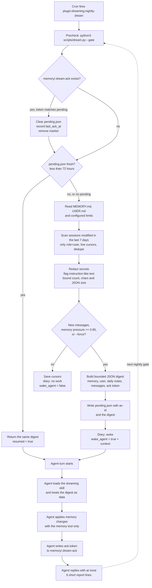
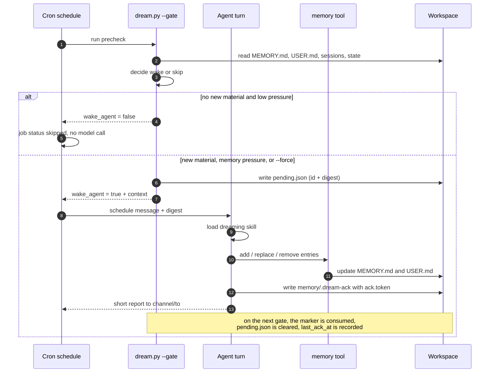

# Dreaming plugin

Nightly memory consolidation for PicoClaw. The plugin declares one host-managed
cron schedule. A small deterministic Python gate runs before the agent turn and
wakes the model only when there is new human material or the memory files are
close to their character limit.

```text
23:00  gate: no new human messages, memory at 41%  -> no model turn
03:00  gate: 17 new messages from 3 sessions       -> one bounded dream turn
```

The gate never calls a model or the network. It reads the workspace, makes no
changes to `MEMORY.md` or `USER.md`, and writes only its own state and the
dream diary. The agent applies the actual memory edits through the regular
`memory` tool.

## What it does

- Reads new `user` messages from `workspace/sessions/*.jsonl`, bounded to 200
  messages / 30k characters, and skips cron, heartbeat, subagent and dream
  sessions.
- Redacts secret-looking tokens and flags instruction-like text; every string
  in the digest is still untrusted data.
- Includes current `memory/MEMORY.md`, `USER.md`, their limits and pressure,
  plus the last few daily notes for context.
- Wakes when there is at least one new human message, when memory pressure is
  at or above 85%, or when a previous dream is still waiting for its ack.
- Keeps a pending digest until the agent writes the ack marker, so a failed or
  interrupted turn does not lose the material. The marker lives inside the
  workspace, so the turn does not need shell access to the plugin directories.
- Appends one line per pass to `memory/DREAMS.md`.

PicoClaw session JSONL records have no per-message timestamps. The skill
therefore corroborates a fact across **distinct sessions** rather than distinct
days.

## Workflow

The gate runs before the model, so an empty night costs no tokens. The diagram
begins once the plugin is enabled and `allow_schedules` is granted:



The turn itself only edits memory through the regular tool; the gate owns
state, bounds and the acknowledgement lifecycle:



State transitions:

| State | Meaning |
| --- | --- |
| `no work` | No new human messages and low memory pressure; no model call |
| `woke` | A digest was written to `pending.json` and handed to the agent |
| `resumed` | The previous digest is still unacked and is handed back |
| `completed` | The ack marker matched; pending was cleared and `last_ack_at` recorded |
| `expired` | A pending older than 72 hours is carried into the next digest instead of being dropped |

## Install

Requirements: PicoClaw with plugin-managed schedules (the branch that adds
`allow_schedules`), the cron tool enabled, and Python 3 on the host running the
gateway.

**Disabled by default.** Adding the package does not enable the plugin. The
install command below leaves the entry disabled, so neither the skill nor the
schedule is loaded and no nightly job is created. The schedule exists only
after you explicitly enable the plugin and grant `allow_schedules`.

```bash
# Load the package into config without enabling it.
picoclaw plugin add dreaming --path ./examples/plugins/dreaming
picoclaw plugin validate dreaming --strict
picoclaw plugin test dreaming
```

To opt in, enable the plugin and the schedule grant in `config.json`:

```json
{
  "plugins": {
    "entries": {
      "dreaming": {
        "enabled": true,
        "allow_schedules": true,
        "agents": ["main"]
      }
    }
  },
  "tools": {
    "cron": {
      "enabled": true
    }
  }
}
```

Restart or reload the gateway. The host creates the job
`plugin:dreaming:nightly-dream` in `workspace/cron/jobs.json` and it starts on
the next 03:00 in the gateway time zone. The host keeps the job ID, run history
and the operator's enabled/disabled choice across restarts and plugin reloads.

## Delivery

The declaration does not hardcode a chat. The job therefore runs in the
default `cli`/`direct` route unless you add a delivery pair. To have the dream
report reach a chat, copy the installed plugin and add `channel` and `to` to the
schedule declaration (both or neither):

```json
{
  "name": "nightly-dream",
  "cron": "0 3 * * *",
  "channel": "telegram",
  "to": "<chat-id>",
  "message": "...",
  "precheck": { "...": "..." }
}
```

Then restart the gateway (or reload its configuration). Reconciliation updates
the stored job in place. The time zone is the gateway process time zone (`TZ`),
not the plugin's.

If you only want a silent nightly pass, leave the delivery fields out; the
dream diary and `picoclaw cron list` still show what happened.

## How the gate decides

The schedule declares:

```json
{
  "precheck": {
    "command": "python3",
    "args": ["${PLUGIN_ROOT}/scripts/dream.py", "--gate"],
    "cwd": "${PLUGIN_DATA}",
    "timeout_seconds": 120
  }
}
```

The process prints one JSON object:

```json
{"wake_agent": false, "reason": "no new human messages and memory below pressure threshold"}
```

```json
{"wake_agent": true, "context": "{\"schema\":1,\"memory\":{...},\"messages\":[...]}"}
```

PicoClaw appends `context` to the schedule message and wakes the agent. A
non-zero exit, invalid JSON or a timeout marks the run as `error` and does not
wake the model. The gate receives:

- `PLUGIN_ROOT`, `PLUGIN_DATA`
- `PICOCLAW_WORKSPACE`
- `PICOCLAW_CRON_JOB_ID`, `PICOCLAW_CRON_JOB_NAME`,
  `PICOCLAW_CRON_DECLARATION_KEY`
- `PICOCLAW_CRON_EXECUTION_ID`, `PICOCLAW_CRON_SOURCE` when available
- `PICOCLAW_AGENT_ID` when the job targets a named agent

## Manual commands

```bash
# What would happen tonight?
python3 scripts/dream.py --status --workspace ~/.picoclaw/workspace \
  --data-dir ~/.picoclaw/plugin-data/dreaming

# Preview the digest without writing state or the diary
python3 scripts/dream.py --gate --dry-run --workspace ~/.picoclaw/workspace \
  --data-dir ~/.picoclaw/plugin-data/dreaming

# Force one pass even with no new messages
python3 scripts/dream.py --gate --force --workspace ~/.picoclaw/workspace \
  --data-dir ~/.picoclaw/plugin-data/dreaming

# Mark a processed pass as complete
python3 scripts/dream.py --ack --workspace ~/.picoclaw/workspace \
  --data-dir ~/.picoclaw/plugin-data/dreaming
```

## Files

| Path | Owner | Purpose |
| --- | --- | --- |
| `plugin-data/dreaming/state.json` | gate | Cursors, recent hashes, timestamps |
| `plugin-data/dreaming/pending.json` | gate | Digest waiting for the agent's ack |
| `workspace/memory/.dream-ack` | agent | Temporary ack marker, written with `write_file` and removed by the next gate |
| `workspace/memory/DREAMS.md` | gate | Append-only dream diary |
| `workspace/memory/MEMORY.md` | `memory` tool | Durable facts; never written by the gate |
| `workspace/USER.md` | `memory` tool | User profile; never written by the gate |

## Limits and safety

- The gate is deterministic and offline: no API key, no network, no model.
- It reads session history, so treat the workspace as sensitive; everything
  stays local. Only the bounded digest reaches the configured model.
- Secret-looking values are redacted before the digest is written. Messages
  are still untrusted input; the skill and the schedule prompt both say so.
- At most 32 schedules per plugin; this package declares one.
- The gate runs with the gateway user's permissions. Install only trusted
  packages, exactly like hooks and MCP servers.

## Not included yet

This is the foundation, not a complete memory-consolidation stack:

- no fact store, trust scores, fact history or retrieval feedback;
- no per-message dates, so corroboration is per session;
- no cloud judge, proposal numbers or merge approvals;
- no separate extraction job; the nightly turn does extraction and
  consolidation in one pass.

The extension points are deliberately small: `scripts/dream.py` owns the
deterministic policy, the skill owns the judgment, and the core schedule
precheck owns the wake decision.
